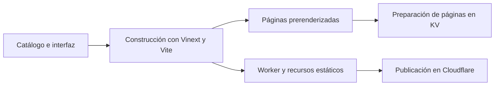
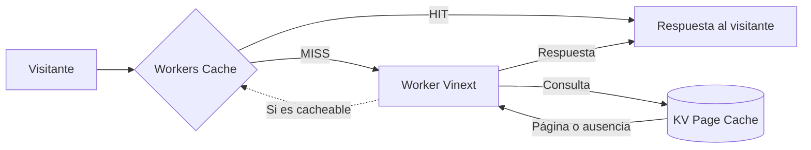

# Arquitectura y entrega

MoliMarket es una vitrina para explorar emprendimientos y sus productos o servicios. Los detalles del catálogo se mantienen en fuentes del proyecto; la coordinación de pedidos continúa mediante los canales de cada emprendimiento.

## Interfaz y experiencia

La interfaz usa React y TypeScript, con Tailwind CSS para los estilos y Zustand para parte del estado. Ofrece vistas adaptadas a móvil y escritorio, fichas y una sección de productos con filtros combinables.

La búsqueda por frases del sitio interpreta criterios mediante reglas locales y los traduce a filtros visibles. Por ejemplo, puede reconocer una categoría y un presupuesto y conservar criterios en algunas consultas de seguimiento. Esta experiencia pública no utiliza un modelo generativo para interpretar cada petición.

## Preparación y publicación

El proyecto usa Vinext y Vite para construir el sitio para Cloudflare. La construcción prepara páginas con prerender y recursos estáticos; una fase de publicación carga el Worker y los recursos, y prepara entradas de caché de páginas en Workers KV.

Las operaciones de publicación se realizan cuando el responsable las autoriza; las comprobaciones de integración continua no publican el sitio por sí solas.

## Entrega de una página

Workers Cache puede devolver una respuesta previamente almacenada antes de ejecutar el Worker. Si no hay una respuesta utilizable, el Worker de Vinext atiende la solicitud y consulta la caché de páginas en KV. Si no encuentra una copia válida, puede renderizar la página. Una respuesta cacheable puede guardarse para solicitudes posteriores.

Este esquema resume el recorrido de páginas y respuestas cacheables. No representa todas las condiciones de bypass o revalidación. Los archivos estáticos, como imágenes, hojas de estilo y JavaScript, se distribuyen mediante Cloudflare Static Assets. KV se utiliza aquí como caché de páginas, no como base de pedidos o cuentas de visitantes.

**Cómo interpretar una comprobación:** una cabecera de caché observada en una respuesta describe esa respuesta; por sí sola no demuestra que en esa visita se haya realizado una nueva lectura de KV.

## Metadatos y medición

El sitio incorpora metadatos por página, sitemap y datos estructurados. Google Analytics 4 se carga cuando existe consentimiento para analítica. Los eventos de interacción aportan información de navegación: un clic de contacto, por sí solo, no demuestra una venta.
