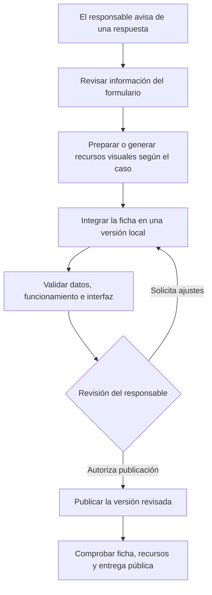

# Pipeline de incorporación de marcas asistido por IA

El pipeline es un **flujo de trabajo asistido por un agente de IA** para convertir información recibida mediante un formulario en una ficha preparada para la web. Combina herramientas, comprobaciones y decisiones humanas.

El flujo comienza cuando el responsable avisa que hay una respuesta por procesar. No existe un disparador que ejecute por sí solo todas las etapas al recibirse el formulario.

## Etapas

1. **Aviso y lectura.** El responsable identifica que hay una nueva respuesta. Durante la sesión, el agente accede a la información pertinente mediante las herramientas disponibles.
2. **Preparación.** Se revisan los campos y recursos aportados. Según el caso, se preparan imágenes existentes o se generan nuevas composiciones, que después se adaptan a sus usos en la interfaz.
3. **Integración local.** Se incorpora la ficha al catálogo y se conectan los recursos necesarios en una versión de trabajo.
4. **Comprobaciones.** Se validan datos, referencias e imágenes y se revisa la experiencia en móvil y escritorio. Las herramientas locales del MCP pueden apoyar algunas consultas y revisiones del catálogo.
5. **Revisión humana.** El responsable examina la ficha y decide si necesita ajustes. Los datos comerciales que requieren confirmación se consultan, no se inventan.
6. **Publicación autorizada.** Una vez aprobada, se prepara y despliega la versión elegida. Después se comprueba la ficha pública y sus recursos.

## Rol de la IA y límites

El agente ayuda a ejecutar tareas del proceso durante una sesión de trabajo. La creación de imágenes depende de las herramientas disponibles y de la necesidad de cada caso: no significa que se generen solas al recibir una respuesta.

La revisión humana y la autorización de publicación forman parte del flujo. La validación técnica puede detectar problemas de estructura, referencias o archivos, pero no confirma por sí sola la vigencia de precios, existencias o condiciones comerciales.

El MCP es un protocolo para que un cliente invoque herramientas concretas del catálogo. **No es el disparador del pipeline**, no genera las imágenes y no publica el sitio.
