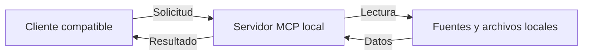

# MCP privado del catálogo

El proyecto incorpora un servidor local basado en **Model Context Protocol (MCP)**. Un cliente compatible, como Codex, puede descubrir y llamar herramientas para trabajar con datos del catálogo desde el entorno de desarrollo.

La comunicación usa `stdio` y las herramientas devuelven resultados estructurados. El servidor de este proyecto funciona en el entorno privado de trabajo y no expone un servicio web público para los visitantes.

## Herramientas

| Herramienta | Función |
| --- | --- |
| `consultar_catalogo` | Consultar negocios o productos con criterios como texto, categoría y precio registrado. |
| `validar_catalogo` | Reutilizar comprobaciones de estructura, identificadores, categorías, referencias, enlaces y archivos. |
| `revisar_imagenes` | Revisar existencia, peso, formato y dimensiones de imágenes registradas. |

Las herramientas son de solo lectura y trabajan sobre las fuentes del proyecto. Permiten automatizar comprobaciones repetitivas **cuando se invocan**. Si se actualizan los datos que el servidor mantiene en memoria, se reinicia para cargar la información actualizada.

## Límites

- El MCP no modifica el catálogo, no genera imágenes ni publica el sitio.
- Los datos consultados representan lo registrado; no confirman stock ni condiciones comerciales en tiempo real.
- Una revisión de formato y dimensiones no sustituye la revisión visual de las imágenes.
- La búsqueda por frases disponible para los visitantes es una función separada, basada en reglas locales.

Las herramientas se han comprobado con pruebas locales, casos válidos y casos de error mediante MCP Inspector y llamadas desde un cliente compatible. Los resultados concretos deben asociarse a la fecha y versión en que se ejecutaron.
